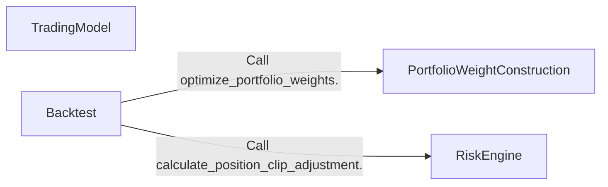
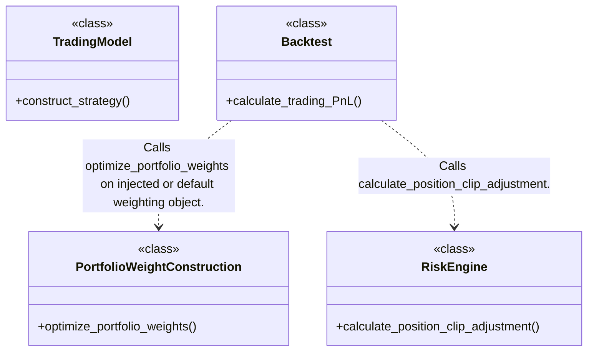
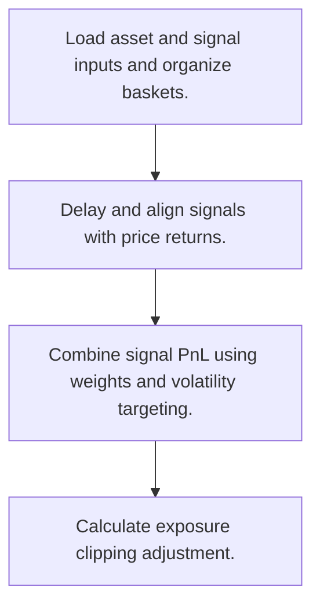
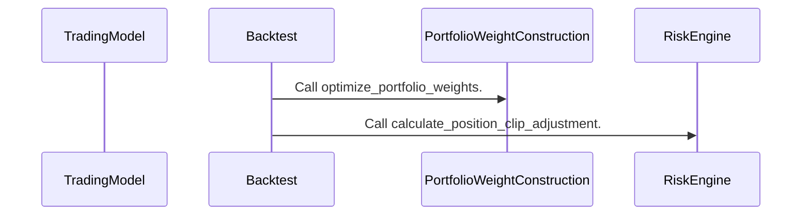

# finmarketpy: workflow, design and architecture

Updated: **2026-10-13**
Reviewed Git hash: `4fb1203b6f08edcac60c179b87114d90b6873567`
Branch: `feature/ayu_develop`
Source diff SHA256: `e3b0c44298fc1c149afbf4c8996fb92427ae41e4649b934ca495991b7852b855`
Scope: **Vectorized quantitative research toolkit** / Maintenance: **active**
Languages: Python

[HTML edition](ayu-develop.html) / [Development](development.md) / [Historical validation](validation.md) / [Full system comparison](../../docs/index.html)

## Purpose and scope

Construct trading signals, calculate return-based portfolio PnL, target volatility, compare exposures and chart results.

## Features and support boundaries

Native = implemented here. Integration = supplied through a named host/API. Limited = material restriction. Not provided = evidenced scope exclusion. Unverified = support/absence not established. Not applicable = outside this artifact type.

| Capability | Status | Implementation and limits | Source |
|---|---|---|---|
| Backtesting | Native | Vectorized historical signal PnL with delay, transaction and roll costs. | [Backtest.calculate_trading_PnL](../src/finmarketpy/backtest/backtestengine.py) ([L121](https://github.com/alexcwyu/finmarketpy/blob/4fb1203b6f08edcac60c179b87114d90b6873567/src/finmarketpy/backtest/backtestengine.py#L121)) |
| Live execution | Unverified | The inspected source does not establish this capability. This is not a claim of absence. | Not applicable to this repository scope. |
| Paper trading | Not applicable | Return-based PnL is the workflow. A broker paper account is outside this computation. | [Backtest.calculate_trading_PnL](../src/finmarketpy/backtest/backtestengine.py) ([L121](https://github.com/alexcwyu/finmarketpy/blob/4fb1203b6f08edcac60c179b87114d90b6873567/src/finmarketpy/backtest/backtestengine.py#L121)) |
| Event driven | Unverified | The inspected source does not establish this capability. This is not a claim of absence. | Not applicable to this repository scope. |
| Vectorized | Native | Aligns pandas frames and calculates returns/PnL across full histories. | [Backtest.calculate_trading_PnL](../src/finmarketpy/backtest/backtestengine.py) ([L121](https://github.com/alexcwyu/finmarketpy/blob/4fb1203b6f08edcac60c179b87114d90b6873567/src/finmarketpy/backtest/backtestengine.py#L121)) |
| Order management | Not applicable | The inspected flow computes portfolio signals and PnL rather than exchange order state. | [Backtest.calculate_trading_PnL](../src/finmarketpy/backtest/backtestengine.py) ([L121](https://github.com/alexcwyu/finmarketpy/blob/4fb1203b6f08edcac60c179b87114d90b6873567/src/finmarketpy/backtest/backtestengine.py#L121)) |
| Order types | Unverified | The inspected source does not establish this capability. This is not a claim of absence. | Not applicable to this repository scope. |
| Multi venue | Unverified | The inspected source does not establish this capability. This is not a claim of absence. | Not applicable to this repository scope. |
| Crypto | Unverified | The inspected source does not establish this capability. This is not a claim of absence. | Not applicable to this repository scope. |
| Equities | Unverified | The inspected source does not establish this capability. This is not a claim of absence. | Not applicable to this repository scope. |
| Futures | Unverified | The inspected source does not establish this capability. This is not a claim of absence. | Not applicable to this repository scope. |
| Options | Unverified | The inspected source does not establish this capability. This is not a claim of absence. | Not applicable to this repository scope. |
| Forex | Unverified | The inspected source does not establish this capability. This is not a claim of absence. | Not applicable to this repository scope. |
| Strategy api | Native | TradingModel load_assets/load_parameters/construct_signal hooks drive baskets. | [TradingModel.construct_strategy](../src/finmarketpy/backtest/backtestengine.py) ([L1042](https://github.com/alexcwyu/finmarketpy/blob/4fb1203b6f08edcac60c179b87114d90b6873567/src/finmarketpy/backtest/backtestengine.py#L1042)) |
| Optimization | Limited | optimize_portfolio_weights constructs configured weights and volatility targeting. This method name is not evidence of a mathematical optimizer or parameter search. | [PortfolioWeightConstruction.optimize_portfolio_weights](../src/finmarketpy/backtest/backtestengine.py) ([L2522](https://github.com/alexcwyu/finmarketpy/blob/4fb1203b6f08edcac60c179b87114d90b6873567/src/finmarketpy/backtest/backtestengine.py#L2522)) |
| Machine learning | Unverified | The inspected source does not establish this capability. This is not a claim of absence. | Not applicable to this repository scope. |
| Reinforcement learning | Unverified | The inspected source does not establish this capability. This is not a claim of absence. | Not applicable to this repository scope. |
| Portfolio | Native | Sum/mean/weighted basket construction and portfolio leverage. | [PortfolioWeightConstruction.optimize_portfolio_weights](../src/finmarketpy/backtest/backtestengine.py) ([L2522](https://github.com/alexcwyu/finmarketpy/blob/4fb1203b6f08edcac60c179b87114d90b6873567/src/finmarketpy/backtest/backtestengine.py#L2522)) |
| Risk management | Native | Signal/portfolio volatility targeting and exposure clipping. Optional SL/TP modifies historical signals. | [Backtest.calculate_trading_PnL](../src/finmarketpy/backtest/backtestengine.py) ([L121](https://github.com/alexcwyu/finmarketpy/blob/4fb1203b6f08edcac60c179b87114d90b6873567/src/finmarketpy/backtest/backtestengine.py#L121)) / [PortfolioWeightConstruction.optimize_portfolio_weights](../src/finmarketpy/backtest/backtestengine.py) ([L2522](https://github.com/alexcwyu/finmarketpy/blob/4fb1203b6f08edcac60c179b87114d90b6873567/src/finmarketpy/backtest/backtestengine.py#L2522)) / [RiskEngine.calculate_position_clip_adjustment](../src/finmarketpy/backtest/backtestengine.py) ([L2880](https://github.com/alexcwyu/finmarketpy/blob/4fb1203b6f08edcac60c179b87114d90b6873567/src/finmarketpy/backtest/backtestengine.py#L2880)) |
| Performance analytics | Native | Computes signal and portfolio PnL and exposures. | [Backtest.calculate_trading_PnL](../src/finmarketpy/backtest/backtestengine.py) ([L121](https://github.com/alexcwyu/finmarketpy/blob/4fb1203b6f08edcac60c179b87114d90b6873567/src/finmarketpy/backtest/backtestengine.py#L121)) / [PortfolioWeightConstruction.optimize_portfolio_weights](../src/finmarketpy/backtest/backtestengine.py) ([L2522](https://github.com/alexcwyu/finmarketpy/blob/4fb1203b6f08edcac60c179b87114d90b6873567/src/finmarketpy/backtest/backtestengine.py#L2522)) |
| Historical data | Integration | TradingModel accepts externally loaded market frames through load_assets hooks. | [TradingModel.construct_strategy](../src/finmarketpy/backtest/backtestengine.py) ([L1042](https://github.com/alexcwyu/finmarketpy/blob/4fb1203b6f08edcac60c179b87114d90b6873567/src/finmarketpy/backtest/backtestengine.py#L1042)) |
| Streaming data | Unverified | The inspected source does not establish this capability. This is not a claim of absence. | Not applicable to this repository scope. |
| Persistence | Unverified | The inspected source does not establish this capability. This is not a claim of absence. | Not applicable to this repository scope. |
| Data pipeline | Native | Signal lagging, aligned market calendars, forward filling and basket construction. | [TradingModel.construct_strategy](../src/finmarketpy/backtest/backtestengine.py) ([L1042](https://github.com/alexcwyu/finmarketpy/blob/4fb1203b6f08edcac60c179b87114d90b6873567/src/finmarketpy/backtest/backtestengine.py#L1042)) / [Backtest.calculate_trading_PnL](../src/finmarketpy/backtest/backtestengine.py) ([L121](https://github.com/alexcwyu/finmarketpy/blob/4fb1203b6f08edcac60c179b87114d90b6873567/src/finmarketpy/backtest/backtestengine.py#L121)) |
| Web ui | Unverified | The inspected source does not establish this capability. This is not a claim of absence. | Not applicable to this repository scope. |
| Cli | Unverified | The inspected source does not establish this capability. This is not a claim of absence. | Not applicable to this repository scope. |
| Monitoring | Unverified | The inspected source does not establish this capability. This is not a claim of absence. | Not applicable to this repository scope. |
| Extension api | Native | Subclass TradingModel and inject a portfolio weighting object. | [TradingModel.construct_strategy](../src/finmarketpy/backtest/backtestengine.py) ([L1042](https://github.com/alexcwyu/finmarketpy/blob/4fb1203b6f08edcac60c179b87114d90b6873567/src/finmarketpy/backtest/backtestengine.py#L1042)) / [Backtest.calculate_trading_PnL](../src/finmarketpy/backtest/backtestengine.py) ([L121](https://github.com/alexcwyu/finmarketpy/blob/4fb1203b6f08edcac60c179b87114d90b6873567/src/finmarketpy/backtest/backtestengine.py#L121)) |
| Native acceleration | Unverified | The inspected source does not establish this capability. This is not a claim of absence. | Not applicable to this repository scope. |
| Distributed execution | Unverified | The inspected source does not establish this capability. This is not a claim of absence. | Not applicable to this repository scope. |

## System components

| Component | Responsibility | Source |
|---|---|---|
| TradingModel | User-overridable model orchestration and basket comparison. | [TradingModel.construct_strategy](../src/finmarketpy/backtest/backtestengine.py) ([L1042](https://github.com/alexcwyu/finmarketpy/blob/4fb1203b6f08edcac60c179b87114d90b6873567/src/finmarketpy/backtest/backtestengine.py#L1042)) |
| Backtest | Vectorized signal-to-return accounting. | [Backtest.calculate_trading_PnL](../src/finmarketpy/backtest/backtestengine.py) ([L121](https://github.com/alexcwyu/finmarketpy/blob/4fb1203b6f08edcac60c179b87114d90b6873567/src/finmarketpy/backtest/backtestengine.py#L121)) |
| PortfolioWeightConstruction | Portfolio weighting and volatility targeting. | [PortfolioWeightConstruction.optimize_portfolio_weights](../src/finmarketpy/backtest/backtestengine.py) ([L2522](https://github.com/alexcwyu/finmarketpy/blob/4fb1203b6f08edcac60c179b87114d90b6873567/src/finmarketpy/backtest/backtestengine.py#L2522)) |
| RiskEngine | Exposure adjustment and leverage policies. | [RiskEngine.calculate_position_clip_adjustment](../src/finmarketpy/backtest/backtestengine.py) ([L2880](https://github.com/alexcwyu/finmarketpy/blob/4fb1203b6f08edcac60c179b87114d90b6873567/src/finmarketpy/backtest/backtestengine.py#L2880)) |

## Architecture and component boundaries

The component view summarizes inspected responsibility boundaries. Arrows identify the documented API/data dependencies; this is not a deployment-readiness claim.

- Call optimize_portfolio_weights.: [Backtest.calculate_trading_PnL](../src/finmarketpy/backtest/backtestengine.py) ([L121](https://github.com/alexcwyu/finmarketpy/blob/4fb1203b6f08edcac60c179b87114d90b6873567/src/finmarketpy/backtest/backtestengine.py#L121))
- Call calculate_position_clip_adjustment.: [Backtest.calculate_trading_PnL](../src/finmarketpy/backtest/backtestengine.py) ([L121](https://github.com/alexcwyu/finmarketpy/blob/4fb1203b6f08edcac60c179b87114d90b6873567/src/finmarketpy/backtest/backtestengine.py#L121))

## Design decisions

| Decision | Rationale | Tradeoff | Evidence |
|---|---|---|---|
| Represent strategy performance as aligned return matrices. | Vectorized signal accounting supports basket and risk comparisons. | It approximates trading costs without an order acknowledgement/fill lifecycle. | [Backtest.calculate_trading_PnL](../src/finmarketpy/backtest/backtestengine.py) ([L121](https://github.com/alexcwyu/finmarketpy/blob/4fb1203b6f08edcac60c179b87114d90b6873567/src/finmarketpy/backtest/backtestengine.py#L121)) |

## Class and interface relationships

Each node is a reviewed source symbol. Function/module nodes are explicitly labeled; they do not imply Python classes. Only reviewed relationships are drawn.

- **TradingModel** (class): [TradingModel.construct_strategy](../src/finmarketpy/backtest/backtestengine.py) ([L1042](https://github.com/alexcwyu/finmarketpy/blob/4fb1203b6f08edcac60c179b87114d90b6873567/src/finmarketpy/backtest/backtestengine.py#L1042))
- **Backtest** (class): [Backtest.calculate_trading_PnL](../src/finmarketpy/backtest/backtestengine.py) ([L121](https://github.com/alexcwyu/finmarketpy/blob/4fb1203b6f08edcac60c179b87114d90b6873567/src/finmarketpy/backtest/backtestengine.py#L121))
- **PortfolioWeightConstruction** (class): [PortfolioWeightConstruction.optimize_portfolio_weights](../src/finmarketpy/backtest/backtestengine.py) ([L2522](https://github.com/alexcwyu/finmarketpy/blob/4fb1203b6f08edcac60c179b87114d90b6873567/src/finmarketpy/backtest/backtestengine.py#L2522))
- **RiskEngine** (class): [RiskEngine.calculate_position_clip_adjustment](../src/finmarketpy/backtest/backtestengine.py) ([L2880](https://github.com/alexcwyu/finmarketpy/blob/4fb1203b6f08edcac60c179b87114d90b6873567/src/finmarketpy/backtest/backtestengine.py#L2880))

## Workflow

### Representative source-backed flow

The steps describe the inspected implementation. User configuration and data inputs are external prerequisites.

1. Load asset and signal inputs and organize baskets.. [TradingModel.construct_strategy](../src/finmarketpy/backtest/backtestengine.py) ([L1042](https://github.com/alexcwyu/finmarketpy/blob/4fb1203b6f08edcac60c179b87114d90b6873567/src/finmarketpy/backtest/backtestengine.py#L1042))
2. Delay and align signals with price returns.. [Backtest.calculate_trading_PnL](../src/finmarketpy/backtest/backtestengine.py) ([L121](https://github.com/alexcwyu/finmarketpy/blob/4fb1203b6f08edcac60c179b87114d90b6873567/src/finmarketpy/backtest/backtestengine.py#L121))
3. Combine signal PnL using weights and volatility targeting.. [Backtest.calculate_trading_PnL](../src/finmarketpy/backtest/backtestengine.py) ([L121](https://github.com/alexcwyu/finmarketpy/blob/4fb1203b6f08edcac60c179b87114d90b6873567/src/finmarketpy/backtest/backtestengine.py#L121)) / [PortfolioWeightConstruction.optimize_portfolio_weights](../src/finmarketpy/backtest/backtestengine.py) ([L2522](https://github.com/alexcwyu/finmarketpy/blob/4fb1203b6f08edcac60c179b87114d90b6873567/src/finmarketpy/backtest/backtestengine.py#L2522))
4. Calculate exposure clipping adjustment.. [Backtest.calculate_trading_PnL](../src/finmarketpy/backtest/backtestengine.py) ([L121](https://github.com/alexcwyu/finmarketpy/blob/4fb1203b6f08edcac60c179b87114d90b6873567/src/finmarketpy/backtest/backtestengine.py#L121)) / [RiskEngine.calculate_position_clip_adjustment](../src/finmarketpy/backtest/backtestengine.py) ([L2880](https://github.com/alexcwyu/finmarketpy/blob/4fb1203b6f08edcac60c179b87114d90b6873567/src/finmarketpy/backtest/backtestengine.py#L2880))

## Sequence

Representative calls and data dependencies

Messages represent inspected calls or explicitly labelled data dependencies. A data dependency is not an asserted direct runtime call.

- Call optimize_portfolio_weights.: [Backtest.calculate_trading_PnL](../src/finmarketpy/backtest/backtestengine.py) ([L121](https://github.com/alexcwyu/finmarketpy/blob/4fb1203b6f08edcac60c179b87114d90b6873567/src/finmarketpy/backtest/backtestengine.py#L121))
- Call calculate_position_clip_adjustment.: [Backtest.calculate_trading_PnL](../src/finmarketpy/backtest/backtestengine.py) ([L121](https://github.com/alexcwyu/finmarketpy/blob/4fb1203b6f08edcac60c179b87114d90b6873567/src/finmarketpy/backtest/backtestengine.py#L121))

## Strengths and limits

### Strengths

- Risk targeting and portfolio construction are visible in the signal/PnL pipeline. [Backtest.calculate_trading_PnL](../src/finmarketpy/backtest/backtestengine.py) ([L121](https://github.com/alexcwyu/finmarketpy/blob/4fb1203b6f08edcac60c179b87114d90b6873567/src/finmarketpy/backtest/backtestengine.py#L121)) / [PortfolioWeightConstruction.optimize_portfolio_weights](../src/finmarketpy/backtest/backtestengine.py) ([L2522](https://github.com/alexcwyu/finmarketpy/blob/4fb1203b6f08edcac60c179b87114d90b6873567/src/finmarketpy/backtest/backtestengine.py#L2522)) / [RiskEngine.calculate_position_clip_adjustment](../src/finmarketpy/backtest/backtestengine.py) ([L2880](https://github.com/alexcwyu/finmarketpy/blob/4fb1203b6f08edcac60c179b87114d90b6873567/src/finmarketpy/backtest/backtestengine.py#L2880))

### Limitations

- RiskEngine absolute exposure branch references portfolio_abs_exposure established in the net exposure branch. Static review does not establish that max_abs_exposure alone is safe. [RiskEngine.calculate_position_clip_adjustment](../src/finmarketpy/backtest/backtestengine.py) ([L2880](https://github.com/alexcwyu/finmarketpy/blob/4fb1203b6f08edcac60c179b87114d90b6873567/src/finmarketpy/backtest/backtestengine.py#L2880))

## Validation scope

The linked validation and command records preserve actual historical runs and user-authorized exclusions. This source/document review does not rerun application tests, establish live trading readiness or rank benchmark performance. Current data, credential and runtime prerequisites remain material.

[Repository validation](validation.md) / [Executed checks](maintenance/index.md)

## Source map

| Reviewed symbol/path | Inspected responsibility | Actual file SHA256 |
|---|---|---|
| [TradingModel.construct_strategy](../src/finmarketpy/backtest/backtestengine.py) ([L1042](https://github.com/alexcwyu/finmarketpy/blob/4fb1203b6f08edcac60c179b87114d90b6873567/src/finmarketpy/backtest/backtestengine.py#L1042)) | Loads market assets through subclass hooks, organizes baskets, builds individual strategies and optionally runs basket work in a worker pool. | `51ba181a64e1297a11bf4b11323009c992e6b279f03aac9fff511dc83807893e` |
| [Backtest.calculate_trading_PnL](../src/finmarketpy/backtest/backtestengine.py) ([L121](https://github.com/alexcwyu/finmarketpy/blob/4fb1203b6f08edcac60c179b87114d90b6873567/src/finmarketpy/backtest/backtestengine.py#L121)) | Shifts signals by configured delay, aligns prices, computes returns, applies optional stops and calls PortfolioWeightConstruction and RiskEngine. | `51ba181a64e1297a11bf4b11323009c992e6b279f03aac9fff511dc83807893e` |
| [PortfolioWeightConstruction.optimize_portfolio_weights](../src/finmarketpy/backtest/backtestengine.py) ([L2522](https://github.com/alexcwyu/finmarketpy/blob/4fb1203b6f08edcac60c179b87114d90b6873567/src/finmarketpy/backtest/backtestengine.py#L2522)) | Computes signal PnL with transaction/roll costs, combines sum/mean/weighted baskets and applies configured volatility targeting. | `51ba181a64e1297a11bf4b11323009c992e6b279f03aac9fff511dc83807893e` |
| [RiskEngine.calculate_position_clip_adjustment](../src/finmarketpy/backtest/backtestengine.py) ([L2880](https://github.com/alexcwyu/finmarketpy/blob/4fb1203b6f08edcac60c179b87114d90b6873567/src/finmarketpy/backtest/backtestengine.py#L2880)) | Calculates exposure-based clipping factors from configured net/absolute exposure limits and rebalance frequency. | `51ba181a64e1297a11bf4b11323009c992e6b279f03aac9fff511dc83807893e` |

## Documentation provenance

Review date: 2026-10-13. Full committed source HEAD: `4fb1203b6f08edcac60c179b87114d90b6873567`. Template version: 2. 1 source files were independently hashed for this guide.

[Evidence catalog](../../docs/systems-2026-10-13/catalog.json) / [Standard template](../../docs/guidelines/APP_TEMPLATE.md)

- Snapshot provenance: inventory.json full HEAD 4fb1203b6f08edcac60c179b87114d90b6873567, branch feature/ayu_develop. Source was inspected in the existing checkout and no repository files were changed.
- Inspected implementation bodies and existing architecture documentation. This is a representative static source audit, not a runtime or live-service validation. Credential exclusions in current validation are policy, not evidence that a live connection succeeds.
- Inspected source files: src/finmarketpy/backtest/backtestengine.py
