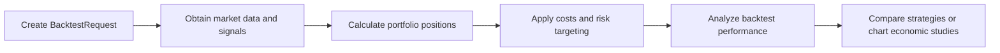
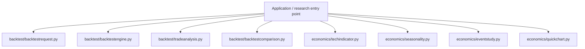
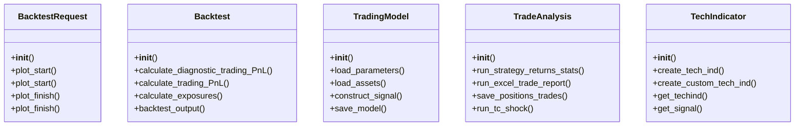
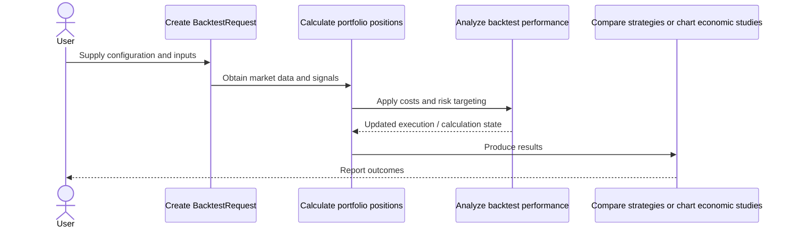
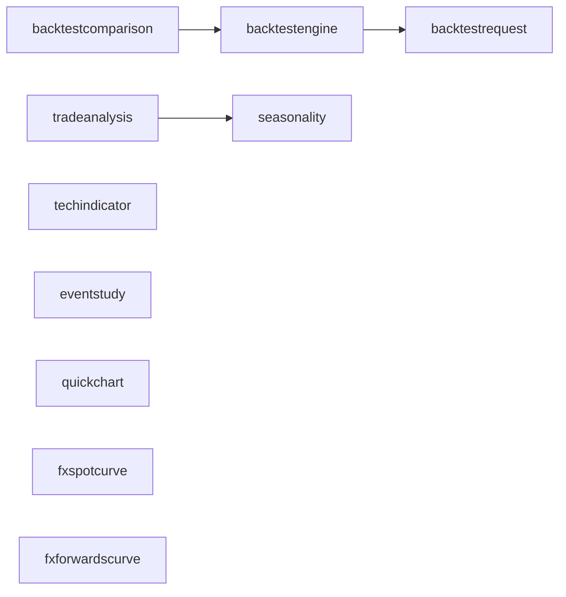
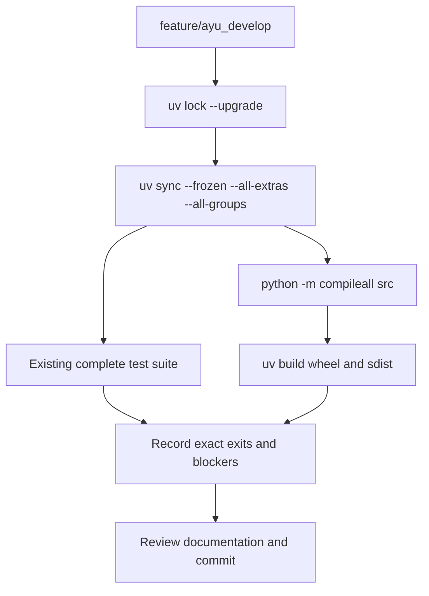

# finmarketpy: development, architecture and operations

Updated 2026-10-12 on `feature/ayu_develop`; source snapshot `e194a39d6f46`. This guide follows the source in this checkout and separates available interfaces from verification evidence.

## Purpose and feature boundaries

Market research and vectorized strategy backtesting with technical indicators, risk targeting, economic event studies, seasonality and FX total-return curves.

findatapy supplies market-data abstractions and chartpy supplies charting. Backtest requests carry trading costs, volatility targeting and position constraints. Economics and curve modules are independent analysis layers on top of time series. MarketConstants centralizes parallelism and roll conventions; provider credentials and optional pricing libraries control which external workflows are runnable.

## Main workflow

The following is the repository-specific logical workflow. Runtime execution details remain in the linked source and the validation record.

1. Create BacktestRequest.
2. Obtain market data and signals.
3. Calculate portfolio positions.
4. Apply costs and risk targeting.
5. Analyze backtest performance.
6. Compare strategies or chart economic studies.

## Components and ownership

The entry point composes the source modules below; arrows indicate review/navigation boundaries rather than a claim that every module is called in every run.

| Source | Declared classes / functions | Implementation role |
|---|---|---|
| [src/finmarketpy/backtest/backtestrequest.py](../src/finmarketpy/backtest/backtestrequest.py) | BacktestRequest | See the public declarations and implementation linked here. |
| [src/finmarketpy/backtest/backtestengine.py](../src/finmarketpy/backtest/backtestengine.py) | Backtest, TradingModel, PortfolioWeightConstruction, RiskEngine | See the public declarations and implementation linked here. |
| [src/finmarketpy/backtest/tradeanalysis.py](../src/finmarketpy/backtest/tradeanalysis.py) | TradeAnalysis | See the public declarations and implementation linked here. |
| [src/finmarketpy/backtest/backtestcomparison.py](../src/finmarketpy/backtest/backtestcomparison.py) | BacktestComparison | See the public declarations and implementation linked here. |
| [src/finmarketpy/economics/techindicator.py](../src/finmarketpy/economics/techindicator.py) | TechIndicator, TechParams | See the public declarations and implementation linked here. |
| [src/finmarketpy/economics/seasonality.py](../src/finmarketpy/economics/seasonality.py) | Seasonality | See the public declarations and implementation linked here. |
| [src/finmarketpy/economics/eventstudy.py](../src/finmarketpy/economics/eventstudy.py) | EventStudy, EventsFactory, HistEconDataFactory | See the public declarations and implementation linked here. |
| [src/finmarketpy/economics/quickchart.py](../src/finmarketpy/economics/quickchart.py) | QuickChart | See the public declarations and implementation linked here. |
| [src/finmarketpy/curve/fxspotcurve.py](../src/finmarketpy/curve/fxspotcurve.py) | FXSpotCurve; _spot_index_numba, _spot_index | See the public declarations and implementation linked here. |
| [src/finmarketpy/curve/fxforwardscurve.py](../src/finmarketpy/curve/fxforwardscurve.py) | FXForwardsCurve | See the public declarations and implementation linked here. |
| [src/finmarketpy/curve/fxoptionscurve.py](../src/finmarketpy/curve/fxoptionscurve.py) | FXOptionsCurve | See the public declarations and implementation linked here. |
| [src/finmarketpy/util/marketconstants.py](../src/finmarketpy/util/marketconstants.py) | MarketConstants | See the public declarations and implementation linked here. |
| [src/finmarketpy/__init__.py](../src/finmarketpy/__init__.py) | Package data / configuration | See the public declarations and implementation linked here. |
| [src/finmarketpy/backtest/__init__.py](../src/finmarketpy/backtest/__init__.py) | Package data / configuration | See the public declarations and implementation linked here. |

## Class design

Methods and inheritance edges are taken from the selected declarations in the actual source. A missing edge means composition or an external base is not asserted here.

## End-to-end interaction

This sequence presents the responsibilities of the main workflow, including the state/result boundary. The linked classes and functions provide the exact method-level contract.

## Source dependency direction

These edges are actual explicit imports between the selected source modules. Dynamic imports, re-exports and third-party internals are omitted.

## Design details and extension points

### `BacktestRequest`

Source: [src/finmarketpy/backtest/backtestrequest.py](../src/finmarketpy/backtest/backtestrequest.py).

Contains parameters necessary to define a backtest, including start date, finish date, transaction cost, etc

- `plot_start`: See implementation for the complete contract.
- `plot_start`: See implementation for the complete contract.
- `plot_finish`: See implementation for the complete contract.
- `plot_finish`: See implementation for the complete contract.
- `calc_stats`: See implementation for the complete contract.

### `Backtest`

Source: [src/finmarketpy/backtest/backtestengine.py](../src/finmarketpy/backtest/backtestengine.py).

Conducts backtest for strategies trading assets. Assumes we have an
input of total returns. Reports historical return statistics
and returns time series.

- `calculate_diagnostic_trading_PnL`: Calculates P&L table which can be used for debugging purposes.
- `calculate_trading_PnL`: Calculates P&L of a trading strategy and statistics to be retrieved later
- `calculate_exposures`: Calculates time series for the total longs, short, net and absolute exposure on an aggregated portfolio basis.
- `backtest_output`: See implementation for the complete contract.
- `pnl`: Gets P&L returns of all the individual sub_components of the model (before any portfolio level leverage is applied)

### `TradingModel`

Source: [src/finmarketpy/backtest/backtestengine.py](../src/finmarketpy/backtest/backtestengine.py).

Abstract class which wraps around Backtest, providing convenient functions for analaysis. Implement your own
subclasses of this for your own strategy. See tradingmodelfxtrend_example.py for a simple implementation of a
FX trend following strategy.

- `load_parameters`: Fills parameters for the backtest, such as start-end dates, transaction costs etc. To be implemented by subclass. Can overwrite it with our own BacktestRequest.
- `load_assets`: Loads time series for the assets to be traded and also for data for generating signals. Can overwrite it with our own BacktestRequest.
- `construct_signal`: Constructs signal from pre-loaded time series
- `save_model`: Save the model instance as as pickle.
- `load_model`: Load the pickle of the saved model. :param path: path to pickle. :return: TradingModel instance.

### `TradeAnalysis`

Source: [src/finmarketpy/backtest/tradeanalysis.py](../src/finmarketpy/backtest/tradeanalysis.py).

Applies some basic trade analysis for a trading strategy (as defined by TradingModel). Use PyFolio to create some
basic trading statistics. Also allows you test multiple parameters for a specific strategy (like TC).

- `run_strategy_returns_stats`: Plots useful statistics for the trading strategy using various backends
- `run_excel_trade_report`: run_excel_trade_report - Creates an Excel spreadsheet with model returns and latest trades
- `save_positions_trades`: See implementation for the complete contract.
- `run_tc_shock`: See implementation for the complete contract.
- `run_arbitrary_sensitivity`: See implementation for the complete contract.

### `TechIndicator`

Source: [src/finmarketpy/economics/techindicator.py](../src/finmarketpy/economics/techindicator.py).

Calculates various technical indicators and associated trading signals.

- `create_tech_ind`: See implementation for the complete contract.
- `create_custom_tech_ind`: See implementation for the complete contract.
- `get_techind`: See implementation for the complete contract.
- `get_signal`: See implementation for the complete contract.

## Repository layout and resources

Installable packages live under `src/`. `pyproject.toml` defines package metadata, build requirements, optional integrations and development dependencies; `uv.lock` records resolved versions, and `.python-version` selects the local interpreter. This layout keeps an accidental checkout import from substituting for the installed wheel. Package resources remain beside their owning modules and are included by the build backend. Existing upstream examples, fixtures, scripts and documentation retain their separate roles.

## Maintenance compatibility and evidence

- The complete supplied tests pass with current scientific dependencies.
- findatapy 0.1.42 and chartpy 0.1.16 still use deprecated UTC constructors upstream. Verified licensed local sources preserve naive-UTC results and have documented hashes, refresh/retirement instructions and original licenses.
- Chartpy imports Plotly private OHLC machinery removed in Plotly6; Plotly>=5.24.1,<6 is the proven compatible range.
- The source archive includes vendor sources; uv sources select them. Ordinary wheel installers do not interpret tool.uv.sources, so use the documented uv checkout/sdist workflow to reproduce these patches.

## Development and verification workflow

See [development commands](development.md) and [validation evidence](validation.md) for interpreter selection, dependency exceptions, full-suite results and remaining blockers. No additional test cases were introduced by this maintenance.
